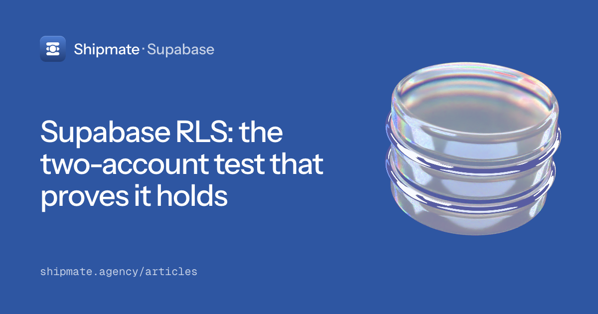

  

# Supabase RLS Audit Pack (1-Query Postgres Check)

Paste [`audit-rls.sql`](./audit-rls.sql) directly into the **Supabase SQL Editor** (read-only `SELECT` query, zero mutations) to surface the three misconfigurations that leak customer rows through your public `anon` key:

1. **`rls_disabled_in_public`** — Every `public.*` table with Row Level Security turned off.
2. **`policy_using_true_write`** — Every `ALL` / `INSERT` / `UPDATE` / `DELETE` policy allowing everyone via `USING (true)` or `WITH CHECK (true)`.
3. **`security_definer_view`** — Every `public.*` view missing `security_invoker = true` (which silently bypasses underlying table RLS).

## How to Run
1. Open **Supabase Dashboard → SQL Editor → New Query**.
2. Paste [`audit-rls.sql`](./audit-rls.sql) and click **Run**.
3. Fix each returned row using the exact SQL patterns in [How to fix `rls_disabled_in_public` & `security_definer_view`](https://shipmate.agency/articles/supabase-rls-disabled-in-public-fix).
4. Verify multi-tenant boundaries with a real [two-account RLS isolation test](https://shipmate.agency/articles/supabase-rls-two-account-test).

## Want a Human to Check Every Table, RPC & API Route?
- **Free passive check ($0, no card):** https://shipmate.agency/check
- **Launch Lockdown ($950 once, 1 PR) · Pentest + Letter ($2,950 once):** https://shipmate.agency
- **Related:** [`shipready` CLI](https://github.com/Shipmate-agency/shipready) · [`shipready-mcp`](https://github.com/Shipmate-agency/shipready-mcp) · [Shipmate Open Source](https://github.com/Shipmate-agency)
